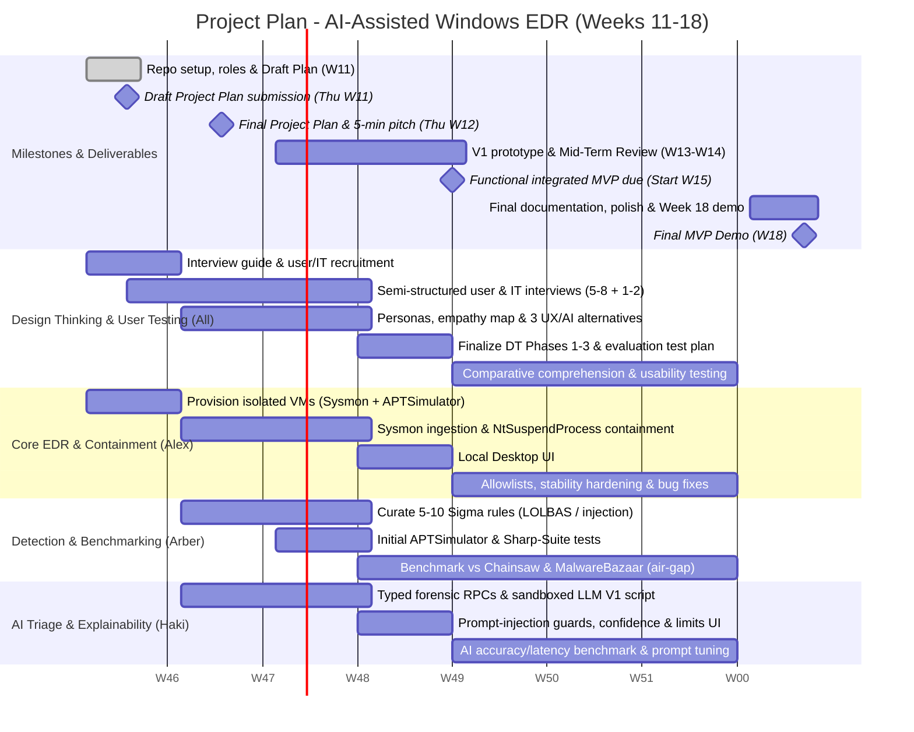

# **Project Plan: AI-Assisted Windows EDR**

**Group:** Team Triple Threat  
**Course:** AI for Good Minor \- Term 2 Group Project (Weeks 11–20)  
**Members & Roles:** Arbër Deda, Alex Wrobel, Haki Abdulovski

---

## **1\. Problem Statement**

**What problem:** Modern cyberattacks increasingly rely on stealthy, "fileless" techniques-such as process hollowing, DLL/APC injection, and abuse of legitimate Windows tools ("Living off the Land" binaries/scripts like PowerShell, cmd, or mshta, known as LOLBAS)-to steal data or deploy ransomware without dropping traditional malware files onto disk.

Traditional signature-based malware detection may struggle to identify fileless attacks. Although modern antivirus solutions also use behavioural detection, some suspicious activities can remain difficult to identify and interpret. Commercial EDR solutions are available to small businesses, but they may still present barriers for self-employed professionals in terms of cost, complexity, licensing requirements, and the technical knowledge needed to interpret security alerts.

**For whom:**

Self-employed professionals (zzp'ers) in the Netherlands who use and manage their own Windows 11 computer for work, have limited cybersecurity knowledge, and do not have dedicated IT or cybersecurity support.

**Why it matters:** A single undetected fileless intrusion or ransomware payload can permanently lock individuals or small organizations out of critical files, expose personal data, and cause severe financial or emotional harm. Conversely, aggressive automated deletion of unknown processes risks breaking legitimate software or operating system stability. Users need real-time containment that pauses suspicious execution safely and reversibly while translating technical forensics into clear, actionable choices.

**Evidence:**

- Technical threat landscape evidence: Publicly documented attack frameworks and benchmarks (LOLBAS project, Sigma detection rules, APTSimulator, Sharp-Suite) demonstrate how easily standard Windows utilities are abused for memory injection and persistence.  
- Current validation gap (to be addressed in Weeks 11–14): While cybersecurity risks are documented, we have not yet conducted interviews with our selected target audience. We must validate whether self-employed professionals with limited cybersecurity knowledge would use an additional EDR alongside Microsoft Defender Antivirus, and whether AI-assisted explanations improve their understanding of security alerts and help them make informed decisions.
---

## **2\. Relation to the Sustainable Development Goals (SDGs)**

* **Primary SDG \- SDG 9 (Industry, Innovation and Infrastructure):** *Build resilient infrastructure, promote inclusive and sustainable industrialization and foster innovation.* Reliable, accessible cybersecurity is foundational to resilient digital infrastructure. Commercial EDR platforms may present financial and technical barriers for self-employed professionals. This project aims to lower these barriers by combining open detection standards (Sysmon, Sigma) with understandable AI-assisted explanations. 
* **Secondary SDG \- SDG 16 (Peace, Justice and Strong Institutions):** *Promote peaceful and inclusive societies and build effective, accountable institutions.* Reducing successful ransomware, credential theft, and covert endpoint compromise helps protect citizens, students, and small civic/non-profit groups from digital crime and exploitation.

**Who benefits:** Self-employed professionals with limited cybersecurity knowledge benefit from more accessible security alerts and decision-making support. Their clients may also indirectly benefit from improved protection of personal and business information. The project aims to reduce the gap between professional cybersecurity solutions and the resources available to independent professionals.

---

## **3\. Feasibility**

### **Data & Privacy**

* **What data & where from:**  
  1. *Runtime endpoint telemetry:* Real-time Windows Sysmon events (process creation, image loads, network connections, remote threads, registry/persistence changes) generated locally on the user's machine.  
  2. *Detection rules & validation datasets:* Open-source Sigma rules, simulated attack telemetry generated in isolated Virtual Machines (VMs) using APTSimulator and Sharp-Suite, and vetted samples from MalwareBazaar for detection benchmarking.  
* **Privacy:** Endpoint telemetry contains sensitive metadata (usernames, file paths, command-line arguments, IP addresses). To protect user privacy:  
  - Raw Sysmon ingestion, Sigma matching, and containment run 100% locally.  
  - Only minimized, sanitized context needed for triage is passed to the LLM agent via strictly typed forensic RPCs (stripping unnecessary PII/secrets where possible).  
  - If a cloud LLM API is used, users must be explicitly informed what fields leave the device, with opt-in controls and API keys secured via Windows DPAPI.

### **Team Skills & Learning Needs**

* **Existing strengths:**  
  - Arbër Deda:  
    1. **Programming:** Experience with C, C++ and Python.  
    2. **Networking:** Knowledge of TCP/IP, Wi-Fi communication and network protocols.  
    3. **System Integration:** Experience connecting hardware and software, including Raspberry Pi, STM32 and microcontrollers.  
    4. **Troubleshooting:** Able to identify and solve technical problems in software and hardware.  
    5. **Teamwork:** Experience working in Agile teams, using Scrum and dividing tasks across team members.  
  - Alex Wrobel:  
    1. **Programming:** Experience with Python, JavaScript, Java, C and C++.  
    2. **Teamwork:** Experience working with Scrum.  
  - Haki Abdulovski:  
    1. **Programming:** Experience with C, C++ and Python.  
    2. **Networking:** Knowledge of TCP/IP, Wi-Fi communication and network protocols.  
    3. **System Integration:** Experience connecting hardware and software, including Raspberry Pi, STM32 and microcontrollers.  
    4. **Troubleshooting:** Able to identify and solve technical problems in software and hardware.  
    5. **Teamwork:** Experience working in Agile teams, using Scrum and dividing tasks across team members.  
* **What we still need to learn:**  
  - Writing/tuning Sigma rules to balance detection coverage against false positives.  
  - Designing and evaluating deterministic vs. LLM-based triage (latency, hallucination control, confidence/uncertainty display).  
  - Conducting structured Design Thinking user interviews and comprehension/usability tests.

### **Scope (8-Week MVP: Weeks 11–18)**

Per our Concept Review, full enterprise architecture is too large for 8 weeks. We commit to a tightly scoped, testable MVP:

| In Scope (8-Week MVP) | Explicitly Out of Scope (Post-MVP / Future Work) |
| :---- | :---- |
| SYSTEM-level EDR Core Service ingesting real-time Sysmon events | Mutual-heartbeat Watchdog Service & WFP network isolation |
| Sigma-based behavioral detection engine (focused rule subset) | Stateful cross-host/kernel injection graph engine |
| Reversible containment via `NtSuspendProcess` before payload execution | Enterprise mTLS web dashboard & Ed25519-signed remote policies |
| Sandboxed LLM forensic triage agent using strictly typed forensic RPCs (process tree, connections, persistence) | Automated cloud remediation / autonomous deletion without human approval |
| Local UI showing AI explanation, confidence/limits, and Approve/Terminate/Resume controls | Non-Windows platforms (macOS / Linux) |
| Benchmarking in isolated VMs \+ user comprehension testing with real users | Production kernel-mode driver development |

### **Key Risks & Mitigations**

1. **False-positive process freezes:** Suspending a critical Windows process or daily-use app could freeze the user's system. *Mitigation:* Maintain a strict allowlist of signed core OS processes, require high-confidence Sigma thresholds before auto-freezing, and make "Resume Process" one click away.  
2. **Scope creep:** Attempting Watchdog/WFP or the enterprise dashboard would jeopardize a working Week 18 demo. *Mitigation:* Enforce the MVP scope table above; defer enterprise features to documentation/roadmap.  
3. **Malware testing safety:** Running live samples on host machines risks infection. *Mitigation:* Perform all testing on snapshotted, network-isolated VMs using APTSimulator/Sharp-Suite first, restricting any MalwareBazaar binaries to air-gapped VMs.  
4. **LLM latency, cost, or hallucination:** Slow or inaccurate AI explanations delay user decisions or mislead users. *Mitigation:* Keep containment instant and deterministic (Sigma \+ `NtSuspendProcess` runs before the LLM); constrain the LLM to typed RPC facts and display uncertainty/raw evidence alongside the summary.

---

## 4. Users and Stakeholders

### Target Audience and Customer Segmentation

Our initial target audience consisted of individual Windows users. However, this group was too broad because Windows users differ in their technical knowledge, responsibilities, behaviour, and cybersecurity needs.

To narrow down our target audience, we use the Segmentation, Targeting and Positioning (STP) framework, focusing on firmographic, geographic, technographic, behavioural, and needs-based segmentation.

| Segmentation type | Selected characteristics |
|---|---|
| Geographic | Based in the Netherlands |
| Firmographic | Self-employed professionals without employees (zzp'ers) |
| Technographic | Use and manage their own Windows 11 computer |
| Behavioural | Regularly use email, download files, exchange client documents, and manage their own computer security |
| Technical knowledge | Basic computer skills but limited cybersecurity knowledge |
| Needs-based | Need understandable security alerts and guidance when suspicious activity is detected |
| Resources | No dedicated IT department or ongoing professional cybersecurity support |

### Primary Target Audience

Our primary target audience consists of self-employed professionals in the Netherlands who use their own Windows 11 computer for work, have limited cybersecurity knowledge, and are responsible for their own computer security.

Examples include freelance designers, photographers, translators, and independent administrative professionals who regularly work with client documents and digital information.

These users are both potential customers and end users of our product.

### Research and Justification

According to the Dutch Central Bureau of Statistics (CBS):

- 70% of surveyed self-employed professionals used the same devices for business and personal purposes in 2024.
- 33% carried out ICT security activities entirely by themselves in 2024.
- 24% reported experiencing a phishing or spoofing attack in 2024.
- Only 7% had cybersecurity insurance in 2025.

These findings suggest that cybersecurity is a relevant concern for self-employed professionals, particularly those who manage their own computer security.

Furthermore, research involving more than 6,000 browser users identified misunderstandings surrounding security warnings. Although this research focuses on browser security, it provides supporting evidence for investigating whether clearer explanations can improve security-related decisions.

Our AI-assisted EDR aims to address this problem by translating technical security alerts into understandable explanations and supporting users in making informed decisions about suspicious activity.

The desk research supports our initial target audience selection, but the specific need for an AI-assisted EDR must still be validated through user interviews and prototype testing.

### Expected User Needs

Based on our initial research, we expect our target audience to need:

- Clear security alerts without unnecessary technical terminology.
- An explanation of why an activity is considered suspicious.
- Guidance on what action to take and the possible consequences.
- Protection that minimises unnecessary interruptions to their work.
- Reversible containment to reduce the risk of losing unsaved work.
- Transparency about AI-generated explanations and their limitations.
- Protection of personal and client information.

These expected needs will be validated through interviews.

### Secondary Stakeholders

- **Clients of self-employed professionals:** Indirectly benefit from improved protection of their personal and business information.
- **IT and cybersecurity professionals:** Provide expert feedback on the technical reliability and safety of the product.
- **Software developers and vendors:** May be affected if legitimate applications are incorrectly flagged as suspicious.

### Out-of-Scope User Groups

For the MVP, we do not specifically target:

- Enterprise organisations with dedicated security teams.
- Employees using company-managed computers.
- Cybersecurity professionals as primary end users.
- macOS and Linux users.

### Research & Validation Methods

1. **Stakeholder Map:** Identify the relationships between our target users, their clients, cybersecurity professionals, and existing security providers.

2. **Semi-Structured Interviews (Weeks 12–14):** Interview 5–8 self-employed professionals who match our target audience and 1–2 cybersecurity practitioners. Investigate their current security practices, experiences with security alerts, technical knowledge, and willingness to use an additional security tool.

3. **Personas & Empathy Maps (Weeks 13–14):** Create user personas and empathy maps based on actual interview findings.

4. **Comparative Usability Testing (Weeks 15–17):** Compare a traditional technical security alert with our AI-assisted security alert. Evaluate user comprehension, decision accuracy, ease of use, and appropriate trust in AI-generated explanations.

5. **Evaluation:** Use the research and testing results to determine whether our solution addresses the needs of our selected target audience.

### References

- [CBS – Cybersecuritymonitor 2025: Cybersecurity measures](https://dashboards.cbs.nl/longreads/2026/cybersecuritymonitor-2025/cybersecuritymaatregelen.html)
- [CBS – Cybersecuritymonitor 2025: Cybersecurity incidents](https://dashboards.cbs.nl/longreads/2026/cybersecuritymonitor-2025/cybersecurityincidenten.html)
- [CBS – ICT use among self-employed professionals, 2025](https://www.cbs.nl/nl-nl/cijfers/detail/86121NED)
- [OpenStax – Market Segmentation and Consumer Markets](https://openstax.org/books/principles-marketing/pages/5-1-market-segmentation-and-consumer-markets)
- [OpenStax – Segmentation of B2B Markets](https://openstax.org/books/principles-marketing/pages/5-2-segmentation-of-b2b-markets)
- [An Experience Sampling Study of User Reactions to Browser Warnings in the Field](https://research.google/pubs/an-experience-sampling-study-of-user-reactions-to-browser-warnings-in-the-field/)

## **5\. Why AI?**

A purely deterministic (non-AI) rule engine like Sigma can detect and freeze a suspicious process-and importantly, detection and freezing do not depend on AI, ensuring zero-latency containment. However, non-AI solutions fall short on triage, correlation, and user-facing explanation:

1. **Automated Multi-Step Forensic Correlation:** Investigating *why* a Sigma rule fired requires checking parent-child process trees, command-line flags, active network sockets, and persistence keys. A sandboxed AI agent orchestrates strictly typed forensic RPC calls dynamically based on what triggered the alert, rather than forcing a non-expert user to run manual forensic commands.  
2. **Translating Telemetry into Plain-Language Context:** Static Sigma template messages (e.g., *"Suspicious PowerShell EncodedCommand"*) tell a user *what* rule matched, not *what it means in context* (e.g., *"A macro in an invoice Word document launched hidden PowerShell and tried to contact an unknown IP-this strongly resembles fileless malware"*).  
3. **Explainability & Limits (Benchmark Requirement):** During Week 14–17, we will explicitly benchmark our AI triage agent against deterministic Sigma/Chainsaw baselines on speed, accuracy, false positives, and user comprehension. In the UI itself, the AI will show:  
   - What evidence it inspected (linked directly to the RPC outputs),  
   - Its confidence level and rationale, and  
   - Explicit limitations (e.g., *"AI analysis is advisory; check raw process details if unsure"*), plus documented failure cases where the LLM misinterprets benign admin scripts.

*Note on Knock-out Criterion K3:* Without the AI triage & explanation agent, non-expert users cannot reliably distinguish benign false positives from real attacks on frozen processes-leading to either unsafe blind "Resume" clicks or destructive termination of legitimate apps.

---

## **6\. Ethical Considerations**

* **Safety & False-Positive Harm:** Automatic deletion or system-wide lockouts could destroy user work or brick essential apps. *Mitigation:* Use reversible freezing; protect core OS processes via strict allowlists; keep final termination/resumption strictly human-approved.  
* **Privacy & Data Minimization:** System logs can expose sensitive user activity (filenames, URLs, credentials passed on CLI). *Mitigation:* Process logs locally; sanitize/redact sensitive fields before LLM inference; secure API keys with Windows DPAPI; explore local LLM inference or strict zero-retention API settings.  
* **Prompt Injection & Privilege Escalation:** Malicious process names or command lines crafted by an attacker could attempt to trick the LLM into declaring malware "safe." *Mitigation:* Run the AI agent in a low-privilege sandbox with **read-only, strictly typed forensic RPCs**\-the LLM has zero direct OS execution or containment authority, and raw Sigma severity remains visible to the user.  
* **Misinformation & Over-Reliance (Automation Bias):** Users might blindly trust a confident-sounding AI hallucination. *Mitigation:* Ground every AI claim in verifiable RPC evidence shown alongside the summary, display uncertainty/limits, and test user skepticism during usability trials.  
* **Exclusion & Accessibility:** Technical jargon or inaccessible alert interfaces exclude non-technical, older, or visually impaired users. *Mitigation:* Write explanations at an accessible reading level, design clear high-contrast UI states, and validate comprehension with non-technical participants.

---

## **7\. Collaboration**

* **Team Structure & Roles (3 Members):**  
  - **Alex Wrobel:** Core Service & Containment Lead: Log ingestion, NtSuspendProcess/NtResumeProcess, VM test lab.  
  - **Arber Deda:** Detection & Benchmarking Lead: Sigma rule curation, APTSimulator/Sharp-Suite evaluation, Chainsaw/baseline comparison.  
  - **Haki Abdulovski:** AI Triage & Explainability Lead: Low-privilege AI sandbox, typed forensic RPCs, prompt-injection safeguards, confidence/limit reporting.  
* **Weekly Rhythm:**  
  - **Monday:** Sprint planning (assign GitHub issues for the week, review blockers).  
  - **Wednesday:** Mid-week technical & research sync (30 min).  
  - **Thursday:** Prep progress update, questions, and next steps for supervisor.  
  - **Friday (1 hour):** Mandatory supervisor meeting with all members present.  
* **Communication & Decision Agreements:**  
  - Primary chat: **Discord**  
  - Code & Design Thinking documentation: **GitHub**.  
  - **Git workflow:** Feature branches \+ pull requests requiring at least 1 peer review before merging to `main`.  
  - **Decision-making:** Evidence-based consensus (backed by VM tests or user feedback); if deadlocked after 24 hours, majority vote or escalate to Friday supervisor meeting. If a member falls behind or misses meetings, notify the group 24 hours in advance so tasks can be rebalanced early.

---

## **8\. Plan (Weeks 11–18)**

### **What Our First Version (V1 / Mid-Term) Looks Like (Week 13–14)**

An end-to-end **VM-hosted early prototype** demonstrating:

1. Real-time Sysmon log ingestion \+ a focused set of 5–10 Sigma rules detecting simulated LOLBAS/injection behavior (triggered via APTSimulator).  
2. Automatic process freeze on match.  
3. A basic sandboxed LLM triage script consuming typed process-tree/network JSON to produce a plain-language explanation \+ confidence indicator.  
4. Initial findings from 5+ user/IT interviews (personas, empathy map, and comprehension baseline).

### **What We Deliver by Week 15**

By the start of Week 15, we will deliver a **functional integrated MVP** inside our GitHub repository:

- Working EDR Core Service \+ Sigma detection \+ containment in an isolated Windows VM.  
- Sandboxed AI triage agent connected via typed RPCs.  
- Local desktop UI allowing a user to read the AI explanation (with uncertainty/limits) and click **Terminate** or **Resume**.  
- Completed Design Thinking phases 1–3 (*Empathize, Define, Ideate*) documented on GitHub, plus a test plan for Weeks 15–17 user & detection evaluations.

### Mermaid

