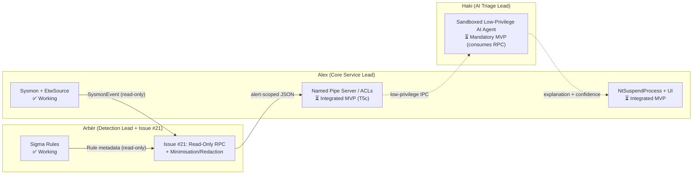

# Issue #21 — Read-Only Forensic RPC: Architecture Report & Implementation Plan

**Status:** Draft – Awaiting Team Approval  
**Owner (Issue #21):** Arbër Deda *(Detection & Benchmarking Lead)*  
**Team Roles ([README.md §7](../../README.md#L213-L216)):**  
- **Arbër Deda:** Detection & Benchmarking Lead *(Sigma rules, APTSimulator/Sharp-Suite, Chainsaw baseline)* + **Issue #21 (Read-Only Forensic RPC Prototype)**  
- **Alex Wrobel:** Core Service & Containment Lead *(Log ingestion, `NtSuspendProcess`/`NtResumeProcess`, VM test lab)*  
- **Haki Abdulovski:** AI Triage & Explainability Lead *(Low-privilege AI sandbox, LLM triage script, prompt-injection safeguards, confidence/limit reporting)*

> [!IMPORTANT]
> **Draft – Awaiting Team Approval (Research & Planning Phase Only):** No source code has been modified, no dependencies installed, and no branches or PRs created. This report is ready for team discussion and approval before implementation starts.

---

## Quick Team Meeting Explanation (Use This to Explain Issue #21)

> *"Right now, our `sigmatch` tool watches Windows Sysmon events and raises Sigma alerts, and we have a separate `threathunter.js` experiment that lets an AI run PowerShell directly as Admin—which breaks our security rules. Issue #21 builds the safe middle bridge instead.*
>
> *Think of Issue #21 as a strict **read-only information counter** between our detection engine and Haki's future AI agent. Instead of letting the AI poke around Windows or kill processes, it can only ask **5 pre-approved questions** scoped strictly to **the specific alert** it is investigating: what triggered the alert, the process family tree (matched safely using Sysmon's unique `ProcessGuid` and timestamps, not just reusable PIDs), redacted command-line details, historical network connections Sysmon saw, and recent persistence events.*
>
> *Before anything reaches the AI, our RPC layer validates both the question and the answer at runtime, strips unneeded Sysmon fields, and blacks out secrets, emails, usernames, and client filenames. For Issue #21, I will build and prove this prototype first using **synthetic fixtures** (~4 hours/week across two weeks within my 10-hour total weekly budget). Then, for our full MVP, we connect it to live Sysmon events and put Haki's AI inside an actual low-privilege sandbox over IPC."*

---

## Executive Summary & Scope Boundaries

1. **Issue #21 Synthetic Prototype vs. Integrated MVP:**
   - **Issue #21 (Stage 1 — Synthetic Prototype):** Builds the read-only Python RPC contract (`rpc_schemas.py`, `rpc_validate.py`, `rpc_redact.py`, `rpc_fixtures.py`, `rpc.py`) and proves schemas, alert-scoping, runtime request/response validation, minimisation/redaction, and essential security checks offline using synthetic `SysmonEvent` fixtures and `pytest`. **Passing synthetic fixture tests does NOT mean the interface is validated on Windows.**
   - **Integrated MVP (Stage 2 — Weeks 15–18 Target):** Connects the RPC contract to live `SysmonEvent` streams (`EventStoreContextProvider`), runs Haki's AI triage agent in a **mandatory sandboxed, low-privilege process/context** ([README.md §3 & §6](../../README.md#L75-L82)), and validates everything end-to-end on an elevated Windows 11 VM ([TESTPLAN_TEAMTRIPLETHREAT.md](../../TESTPLAN_TEAMTRIPLETHREAT.md#L12-L21)).
2. **Mandatory MVP Isolation Preserved:** A sandboxed, low-privilege AI agent is **in scope for the overall MVP**—not pushed to post-MVP. The in-process Issue #21 prototype is only a Phase 1 development step whose strict JSON-serialisable contract makes IPC isolation straightforward when Haki and Alex connect the low-privilege agent.
3. **Total 10 h/week Capacity:** At **10 hours/week total** across team meetings, Sigma curation/benchmarking, research/docs, and coding, Issue #21 **Must Have** tasks are kept to **8.5 hours spread over two weeks (~4–4.5 h/week)**, leaving ~5.5–6 h/week for meetings, documentation, and detection benchmarking.

---

## Part 1 — Understanding the Architecture (In Simple Terms)

### 1.1 What is RPC, and why does our EDR need a read-only one?

**RPC** (**Remote Procedure Call**) is a pattern where one part of a system sends a structured **request** (method name + parameters) to another part and receives a structured **response** (plain JSON-ready data), even when the two parts later run in separate Windows processes with different privilege levels.

From [README.md §3 & §6](../../README.md#L73-L81):
- **Detection (`Sigma`) and containment (`NtSuspendProcess`) must remain 100% independent of AI availability.**
- **The AI must never have OS command execution, process control, or remediation authority.**

Unlike [threathunter.js](../../threathunter/threathunter.js#L80-L214), which gives an LLM elevated `run_powershell` access, a typed read-only RPC counter stops prompt injections from executing commands, stops hallucinating LLMs from terminating legitimate apps, and ensures raw telemetry containing client data is minimised and redacted before AI inference.

### 1.2 How it fits into the existing repository

Our repository already has a working Windows Sysmon + Sigma detection pipeline:

```text
Sysmon (configured by sigmatch/config/sysmon-sigmatch.xml)
  ↓ real-time ETW (~13 ms transport p50 per sources.py / sigmatch README)
EtwSource (sources.py) ──► SysmonEvent (events.py) ──► RuleSet.match() (rules.py)
                                                             │
                    ┌────────────────────────────────────────┴───────────────────────┐
                    ▼ (existing, untouched, deterministic)                           ▼ (Issue #21: read-only lookup)
             GUI / CLI alerts                                                Forensic RPC Gateway (rpc.py)
        MainWindow / LiveMonitor (gui.py)                                    ├── runtime validate request (rpc_validate.py)
        [Alex: NtSuspendProcess + UI actions]                                ├── verify alert scope (rpc.py)
                                                                             ├── fetch from ContextProvider (fixtures / event store)
                                                                             ├── minimise + redact PII (rpc_redact.py)
                                                                             ├── runtime validate response (rpc_validate.py)
                                                                             └── return JSON-ready RPCResponse (rpc_schemas.py)
                                                                                   │
                                                                                   ▼ (Haki: sandboxed low-privilege AI agent)
                                                                             Plain-language explanation + confidence
```

### 1.3 What exists vs. what is missing

**Already working in the repository (kept untouched in Issue #21):**
- **ETW ingestion & event model:** `EtwSource` ([sources.py L54–197](../../sigmatch/sigmatch/sources.py#L54-L197)) and `SysmonEvent` / `event_from_etw` ([events.py L25–159](../../sigmatch/sigmatch/events.py#L25-L159)). Note that Sysmon events carry both `ProcessId` and globally unique braced `ProcessGuid` + `ParentProcessGuid` + `UtcTime` (`normalize_etw_value` in [events.py L100–112](../../sigmatch/sigmatch/events.py#L100-L112)).
- **Sysmon config:** [sysmon-sigmatch.xml](../../sigmatch/config/sysmon-sigmatch.xml#L6-L77) logs ProcessCreate (ID 1), NetworkConnect (ID 3), RegistryEvent persistence/hijack keys (IDs 12–14), WmiEvent (IDs 19–21), and DnsQuery (ID 22).
- **Sigma engine:** `Rule`, `RuleSet`, `load_rules()` ([rules.py L86–146](../../sigmatch/sigmatch/rules.py#L86-L146)), [matchers.py](../../sigmatch/sigmatch/matchers.py), and [condition.py](../../sigmatch/sigmatch/condition.py). Per [sigmatch/README.md](../../sigmatch/README.md#L238-L241), 1,881 standard Sysmon rules (2,256 with extended collections) compile with 0 errors.
- **Desktop GUI, CLI & Tests:** `MainWindow` / `LiveMonitor` ([gui.py L753–813](../../sigmatch/sigmatch/gui.py#L753-L813)), [cli.py](../../sigmatch/sigmatch/cli.py), and 7 test files in `sigmatch/tests/` ([test_etw.py](../../sigmatch/tests/test_etw.py) uses synthetic data off-Windows; `test_live_window_end_to_end` in [test_gui.py L665–716](../../sigmatch/tests/test_gui.py#L665-L716) skips unless elevated on Windows with Sysmon + `pyetwkit`).

**Still missing across the project:**

| Component | Status / MVP Timing | Owner ([README.md §7](../../README.md#L213-L216) + Issue Assignment) |
|---|---|---|
| **Typed read-only forensic RPC prototype + minimisation/redaction** | **Issue #21 (Stage 1)** | **Arbër** |
| **Live `EventStoreContextProvider` wire-up & Windows VM validation** | **Integrated MVP (Stage 2, Week 15+)** | **Arbër + Alex** |
| **Process containment (`NtSuspendProcess`/`NtResumeProcess`), allowlist, UI actions** | **Integrated MVP** | **Alex** |
| **Sandboxed low-privilege AI triage agent, prompt-injection guards, confidence UI** | **Integrated MVP (Mandatory per §3/§6)** | **Haki** *(consumes Issue #21 RPCs)* |
| **Authenticated Named Pipe / IPC boundary between Core Service & sandboxed AI** | **Integrated MVP security boundary (T5c)** | **Alex + Haki** *(uses Issue #21 JSON contract)* |

### 1.4 Team Dependency Flow



---

## Part 2 — Proposed Read-Only RPC Design (Issue #21)

### 2.1 Process Identity (`ProcessGuid` + Timestamps) and Alert-Scoped Access

Two Windows realities shape our interface design:
1. **Windows PIDs are recycled:** Relying solely on `pid: int` risks confusing two completely different processes that reused the same numeric PID over time. Sysmon attaches a unique **`ProcessGuid`** (braced UUID string) and **`UtcTime` timestamp** to each process lifetime. Therefore, our schemas identify process instances by **`process_guid`** (plus `pid`, `ppid`, and `start_time` / `observed_at` timestamps for correlation and display).
2. **No whole-system browsing (Alert-Scoped Access):** To follow least privilege, the AI cannot query arbitrary processes across the machine. **Every RPC method requires `alert_id`**, and `dispatch()` checks that any requested `process_guid` belongs to that alert's correlated scope (the alerted process or its recorded ancestors/children). Asking for an out-of-scope process returns `RPCError(code="ACCESS_DENIED")`.

### 2.2 What Network Context Represents (Historical Observations vs. Active Sockets)

> [!NOTE]
> **Sysmon telemetry limitation:** Sysmon Event ID 3 (`NetworkConnect`) records **connection events observed after monitoring began**. Sysmon does not emit socket-close events or report sockets opened before Sysmon/ETW started. Consequently, our RPC network method returns **historical Sysmon-observed connection records** (clearly labelled with `observed_at` timestamps and `source="sysmon_observed_events"`), **not** a complete real-time OS active-socket table.

### 2.3 The 5 Approved Read-Only Methods

Every method is strictly read-only (`get_*`), validates inputs before execution, checks alert scope, redacts outputs, and validates the response before returning:

| # | Method | Validated Request Params | Response Schema (`RPCResponse.data`) | Purpose & Scope Rule |
|---|---|---|---|---|
| 1 | `get_alert_context` | `alert_id: str` | `AlertContextResponse`: `alert_id`, `timestamp`, `event_id`, `rule_ids`, `rule_titles`, `max_level`, `target_process_guid`, `target_pid`, `image_name`, `minimised_fields` | Entry point: returns what Sigma rule(s) matched and the anchor `target_process_guid` |
| 2 | `get_process_tree` | `alert_id: str`, `process_guid: str \| None = None`, `max_depth: int = 3` (`1..10`) | `ProcessTreeResponse`: `alert_id`, `target: ProcessSummary`, `ancestors: tuple[ProcessSummary, ...]`, `children: tuple[ProcessSummary, ...]`, `truncated: bool` | Returns ancestor/child lineage (each `ProcessSummary` carries `process_guid`, `parent_process_guid`, `pid`, `ppid`, `start_time`, `image_name`, `image_path`, `user_redacted`). `process_guid` defaults to alert's process and must be within `alert_id` scope |
| 3 | `get_command_line_metadata` | `alert_id: str`, `process_guid: str \| None = None` | `CommandLineResponse`: `alert_id`, `process_guid`, `pid`, `start_time`, `image_name`, `command_line`, `parent_command_line`, `original_length`, `was_truncated`, `integrity_level` | Returns minimised, redacted, length-capped (`<= 512` chars) command-line metadata for an in-scope process |
| 4 | `get_network_connections` | `alert_id: str`, `process_guid: str \| None = None`, `limit: int = 20` (`1..50`) | `NetworkConnectionsResponse`: `alert_id`, `process_guid`, `coverage_note` (historical Sysmon observations only), `connections: tuple[ConnectionSummary, ...]`, `total_count`, `truncated` | Returns historical Sysmon-observed connections (`observed_at`, `protocol`, `destination_ip`, `destination_port`, `destination_hostname`, `initiated`) for an in-scope process |
| 5 | `get_persistence_entries` | `alert_id: str`, `limit: int = 20` (`1..50`) | `PersistenceResponse`: `alert_id`, `entries: tuple[PersistenceSummary, ...]`, `total_count`, `truncated` | Returns minimised, redacted persistence observations (`category`, `target_object_redacted`, `details_redacted`, `observed_at`, `source_process_guid`, `source_pid`) linked to `alert_id` |

### 2.4 Standard Envelope & Dual Runtime Validation (Request + Response)

All calls go through `dispatch(method, params, provider)` and **always return** a frozen, JSON-serialisable `RPCResponse`:

```python
ALLOWED_ERROR_CODES = frozenset({
    "METHOD_NOT_ALLOWED",  # method not in 5-method allowlist
    "INVALID_PARAMS",      # request failed runtime validation
    "ACCESS_DENIED",       # process_guid outside alert_id scope
    "NOT_FOUND",           # unknown alert_id or no matching process record
    "RESPONSE_INVALID",    # response failed runtime egress validation (fail-closed)
    "RATE_LIMITED",        # S-1 per-method throttle exceeded
    "INTERNAL_ERROR",      # safe generic failure without stack trace leak
})
```

Why validate **both** inputs and outputs at runtime?
- **Input validation (`validate_request`):** Rejects non-dicts, unexpected keys (e.g., injected `"command"`), missing required keys, `bool` disguised as `int`, out-of-range numbers (`max_depth > 10`), and malformed `alert_id` / `process_guid` formats before any lookup executes.
- **Response validation (`validate_response`):** Acts as a fail-closed **egress gate** right before returning to the AI. If a handler or provider accidentally includes an unapproved field, wrong type, non-JSON-serialisable object, or string exceeding the length cap, `dispatch()` blocks the response and returns `RPCError("RESPONSE_INVALID")`.

### 2.5 Data Minimisation First, Regex Redaction Second

Aligned with [TESTPLAN T6](../../TESTPLAN_TEAMTRIPLETHREAT.md#L19):
1. **Step 1 — Field Allowlist Minimisation & Truncation (Mandatory Primary Control):**
   - Each Sysmon event ID only forwards an explicit allowlist of forensic fields needed for explanation (e.g., dropping `LogonGuid`, `LogonId`, `TerminalSessionId`, `Hashes`, `raw_xml`, and any environment blocks outright).
   - Free-text strings (`CommandLine`, `ParentCommandLine`, `Details`) are capped at a hard maximum length (e.g., **512 characters**).
2. **Step 2 — Privacy Redaction (Secondary Scrubbing aligned with T6):**
   - Scrubs seeded/common sensitive values inside remaining allowed fields:
     - CLI secrets (`--password=`, `-p`, `--token=`, `--api-key=`, `--secret=`, `Bearer ...`) → `[REDACTED_SECRET]`
     - Email addresses → `[REDACTED_EMAIL]`
     - Windows home paths & `DOMAIN\user` strings → `C:\Users\[REDACTED_USER]\...` / `[REDACTED_DOMAIN]\[REDACTED_USER]`
     - Client filenames inside user work folders (`\Documents\`, `\Desktop\`, `\Downloads\`, `\OneDrive\`) → `[REDACTED_FILE].<ext>`
   - **Documented limitations:** Base64-encoded secrets, custom positional passwords without flags, and novel secret parameter names may bypass regex scrubbing; this limitation is documented directly in `rpc_redact.py` and reported under T6.

---

## Part 3 — Architecture Review & Validation Staging

| Concern | How the Design Addresses It |
|---|---|
| **1. Prototype vs. Integrated MVP** | Issue #21 delivers Stage 1 (`FixtureContextProvider` + synthetic `SysmonEvent` E2E tests in CI). It explicitly **does not** claim Windows VM validation. Stage 2 (Weeks 15–18) wires `EventStoreContextProvider` to live `EtwSource`, adds Alex/Haki's sandboxed IPC boundary, and runs live VM tests ([TESTPLAN T1, T5, T6, T8](../../TESTPLAN_TEAMTRIPLETHREAT.md#L14-L21)). |
| **2. Mandatory Sandboxed AI Scope** | A low-privilege sandboxed AI agent with IPC isolation is **not optional or post-MVP** ([README.md §3, §6, §8](../../README.md#L79-L80)). Issue #21 creates the narrow, JSON-serialisable contract (`dispatch()` + `RPCResponse.to_dict()`) so Haki's sandboxed AI process can call it over Named Pipes/IPC without refactoring handlers or schemas. |
| **3. Historical vs. Live Sockets** | `NetworkConnectionsResponse` explicitly models Sysmon Event ID 3 observations with timestamps (`source="sysmon_observed_events"`) and never presents them as a complete live OS socket inventory. |
| **4. `ProcessGuid` & Timestamps** | Tree, CLI, network, and persistence lookups key on `ProcessGuid` + `UtcTime`/`observed_at` timestamps inside `alert_id` scope, preventing recycled-PID collisions. |
| **5. Preserving Existing Code** | Zero edits to `events.py`, `sources.py`, `rules.py`, `matchers.py`, `condition.py`, `gui.py`, `cli.py`, or existing tests during Issue #21. |

### Team Decisions Checklist (Discuss Before Implementation)

- [ ] **D1 (Arbër):** Confirm the per-event field allowlists cover all fields used by our curated 5–10 LOLBAS/injection Sigma rules so AI triage has the matching facts.
- [ ] **D2 (Alex + Arbër):** Confirm how `EventStoreContextProvider` will receive live `(SysmonEvent, matched_rules)` pairs in Stage 2 (e.g., listener on `LiveMonitor` vs. Alex's Core Service).
- [ ] **D3 (Alex + Haki):** Confirm the exact IPC message framing (Named Pipe JSON lines matching `dispatch(method, params)` ↔ `RPCResponse.to_dict()`) needed when connecting Haki's mandatory low-privilege AI sandbox for the integrated MVP.
- [ ] **D4 (All):** Confirm [threathunter.js](../../threathunter/threathunter.js) stays isolated/labelled as an unsafe baseline experiment and will not be connected to `sigmatch`.

---

## Part 4 — Realistic Implementation Plan (10 h/week Total Capacity)

### Capacity Reality Check

Arbër's **total project capacity is 10 hours/week** across all course activities:
- Team & supervisor meetings (~2–2.5 h/week per [README.md §7](../../README.md#L217-L221))
- Detection & benchmarking duties (`det1`/`det2`/`det3`: Sigma curation, APTSimulator/Sharp-Suite tests, Chainsaw comparison) + research/docs (~3.5 h/week)
- **Available coding/testing capacity for Issue #21:** **~4 to 4.5 hours/week**

Therefore, Issue #21 **Must Have** work totals **8.5 hours spread over 2 weeks (~4.25 h/week)** so all team and detection obligations remain protected.

### Must Have — Issue #21 Stage 1 Synthetic Prototype (**8.5 h total over 2 weeks**)

| ID | SMART Task | Est. | Depends on | Deliverable | Measurable Acceptance Criteria | Required Tests |
|---|---|---|---|---|---|---|
| **M-1** | **Frozen schemas, `ProcessGuid` models & `RPCError` envelope** (`ProcessSummary`, historical `ConnectionSummary`, `PersistenceSummary`, 5 response dataclasses, `RPCError`, `RPCResponse`, `.to_dict()`) | 1.5 h | None | `sigmatch/sigmatch/rpc_schemas.py` | All schemas frozen (`@dataclass(frozen=True)`); `.to_dict()` JSON-serialisable; includes `process_guid`, `start_time`/`observed_at`, and `ALLOWED_ERROR_CODES` | `tests/test_rpc_schemas.py`: immutability + `json.dumps()` round-trip for every schema |
| **M-2** | **Runtime request AND response validation** (`validate_request()` + fail-closed `validate_response()` egress gate) | 1.5 h | M-1 | `sigmatch/sigmatch/rpc_validate.py` | Request validator rejects unknown keys, wrong types (`bool`≠`int`), out-of-range values, bad `alert_id`/`process_guid`; response validator blocks missing/extra/oversized egress fields (`RESPONSE_INVALID`) | `tests/test_rpc_validate.py`: happy path + negative tests for both request & malformed response blocking |
| **M-3** | **Read-only dispatcher, alert-scoping & essential security tests** (`dispatch()`, 5-method `frozenset` allowlist, `ContextProvider` protocol, `ACCESS_DENIED` scope guard) | 2.0 h | M-1, M-2, M-4 | `sigmatch/sigmatch/rpc.py` | Only the 5 `get_*` methods succeed; unknown/write methods return `METHOD_NOT_ALLOWED`; out-of-scope `process_guid` returns `ACCESS_DENIED`; AST audit confirms zero `subprocess`/`ctypes`/`os.system`/`socket` imports | `tests/test_rpc.py`: valid calls, method allowlist enforcement, cross-alert `ACCESS_DENIED`, AST dangerous-import check |
| **M-4** | **Minimisation-first + T6 PII/secret redaction** (per-event allowlists, 512-char truncation, scrubbing passwords/tokens, emails, usernames, `\Documents\*.pdf` client filenames; documented gaps) | 1.5 h | M-1 | `sigmatch/sigmatch/rpc_redact.py` | Disallowed fields & `raw_xml` absent; seeded T6 passwords, tokens, emails, usernames, and client filenames 100% absent; idempotent; residual blind spots documented | `tests/test_rpc_redact.py`: essential T6 seeded-secret/PII removal + unexpected-field stripping + benign preservation |
| **M-5** | **Synthetic `ProcessGuid` fixtures & prototype E2E test** (3 deterministic scenarios: benign updater, Word→PowerShell LOLBAS with recycled PID edge case, long/empty CLI; plus `SysmonEvent` → `RuleSet.match()` → `dispatch()` test) | 2.0 h | M-1..M-4 | `rpc_fixtures.py`, `test_rpc_fixtures.py`, `test_rpc_integration.py` | Fixtures use RFC 5737/2606 fictional values & distinct `ProcessGuid`s even with reused PIDs; synthetic E2E flow passes all 5 methods; existing `sigmatch` tests remain passing | `test_rpc_fixtures.py` (determinism + PID-reuse disambiguation) & `test_rpc_integration.py` (Tier 1 CI) |

### Should Have — Extended Hardening (Fits Later Sprint Capacity: **3.0 h total**)

| ID | SMART Task | Est. | Depends on | Deliverable | Measurable Acceptance Criteria |
|---|---|---|---|---|---|
| **S-1** | **Per-method sliding-window rate limiting** | 1.0 h | M-3 | `rpc.py` update + test | Exceeding per-minute limit returns `RPCError("RATE_LIMITED")`; tested with mocked clock |
| **S-2** | **Privacy-safe RPC audit log** (method, status, `error.code`, duration only—no unredacted telemetry) | 0.5 h | M-3, M-4 | `rpc.py` update + test | Log inspection confirms seeded secrets/PII never appear in RPC audit logs (T6) |
| **S-3** | **Extensive adversarial security test suite** (prompt-injection CLI strings, fuzzing oversized/nested params, concurrency checks) | 1.5 h | M-2..M-4 | `tests/test_rpc_security.py` | All extended injection/fuzz cases rejected cleanly without unhandled exceptions |

### Could Have — Optional Demo Helpers (**4.0 h total**, Only After Core Integrated MVP)
- **C-1 (2.5 h):** Read-only "AI Context (Preview)" tab in [gui.py](../../sigmatch/sigmatch/gui.py).
- **C-2 (1.5 h):** CLI `--rpc-json-out` flag in [cli.py](../../sigmatch/sigmatch/cli.py) to export labelled synthetic/redacted bundles for Test Plan T4.

### Out of Scope for Issue #21 Prototype *(Still Required in Overall MVP via Later Issues)*
- **Live Windows `EventStoreContextProvider` & VM integration tests** → Integrated MVP Stage 2 (Week 15+).
- **Sandboxed low-privilege AI agent + Named Pipe IPC transport** → Mandatory overall MVP components owned by Haki + Alex (`M3`, `M7`), built atop Issue #21's contract.
- **Process containment (`NtSuspendProcess`) & User Decision UI** → Alex's deliverables (`M2`, `M5`, `M6`).

### Two-Week Schedule Inside 10 h/week Total Budget

| Week | Issue #21 Work (~4–4.5 h/week) | Other Weekly Work (~5.5–6 h/week) | Total |
|---|---|---|---|
| **Week 1 (e.g., W13)** | **M-1** (1.5 h) + **M-2** (1.5 h) + **M-4** (1.5 h) = **4.5 h** | Team/supervisor meetings (~2.5 h) + Sigma rule curation & docs (~3.0 h) | **10.0 h** |
| **Week 2 (e.g., W14)** | **M-3** (2.0 h) + **M-5** fixtures + E2E test (2.0 h) = **4.0 h** | Team/supervisor meetings (~2.5 h) + APTSimulator/benchmark prep & PR review (~3.5 h) | **10.0 h** |

---

## Part 5 — Proposed File Structure (New Files Only)

```text
sigmatch/
├── sigmatch/
│   ├── (all existing modules UNCHANGED for Issue #21)
│   ├── rpc_schemas.py          ← M-1: Frozen schemas, ProcessGuid models, RPCError, RPCResponse
│   ├── rpc_validate.py         ← M-2: Runtime request & egress response validation
│   ├── rpc_redact.py           ← M-4: Field-allowlist minimisation + T6 PII/secret redactor
│   ├── rpc_fixtures.py         ← M-5: Deterministic ProcessGuid fixtures + FixtureContextProvider
│   └── rpc.py                  ← M-3 (+ S-1/S-2): Read-only dispatcher, alert-scope guard, ContextProvider
└── tests/
    ├── (7 existing test files UNCHANGED)
    ├── test_rpc_schemas.py     ← M-1
    ├── test_rpc_validate.py    ← M-2
    ├── test_rpc.py             ← M-3 (incl. essential security + import audit tests)
    ├── test_rpc_redact.py      ← M-4 (incl. essential T6 PII/secret tests)
    ├── test_rpc_fixtures.py    ← M-5 (incl. PID-reuse disambiguation)
    ├── test_rpc_integration.py ← M-5 (synthetic prototype E2E, Tier 1 CI)
    └── test_rpc_security.py    ← S-3 (Should Have extensive adversarial suite)
```

> [!NOTE]
> **Draft – Awaiting Team Approval:** Once you discuss **D1–D4** with Alex and Haki and give explicit approval, we can start implementing **M-1 (`rpc_schemas.py`)**.
